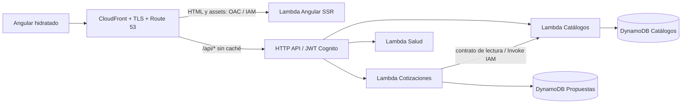

# Arquitectura de CotiTrama

Microservicios serverless en AWS, con Angular SSR alojado en Lambda. El código, los contratos y la plantilla están en este repositorio; el despliegue y las pruebas con servicios administrados son una etapa posterior a la validación local.

## Límites de servicio

| Servicio | Responsabilidad | Datos / permisos |
| --- | --- | --- |
| Web | SSR público, assets, configuración pública y navegación Angular | Sin acceso a tablas de negocio. Function URL IAM sólo invocable por CloudFront OAC. |
| Catálogos | Publicación de revisiones, listado y lectura | Tabla propia. Publicación condicional; una revisión publicada no se edita. |
| Cotizaciones | Motor determinista, simulación, emisión y consulta de snapshots | Tabla propia e invocación de lectura de Catálogos. Sin acceso directo a su tabla. |
| Salud | Respuesta técnica de disponibilidad de la función | Sin datos de negocio; no acredita salud de dependencias. |

Las funciones comparten utilidades de contrato, pero se ejecutan con roles separados. El monorepo no convierte los dominios en un único proceso. Una Lambda no consulta la tabla de otra. En esta primera versión un stack SAM coordina los recursos; separar despliegues de dominio se puede realizar conservando los contratos.

## Frontend y dominios

Angular 22 standalone, rutas lazy por flujo, SignalStore por ruta y HttpClient tipado. El navegador inicia sesión mediante Authorization Code con PKCE. SSR no carga datos comerciales ni serializa tokens en HTML. El backend calcula todos los importes.

Se reutiliza el patrón del portafolio: Express + AngularNodeAppEngine + serverless-http dentro de Lambda Node.js 24 arm64. CloudFront usa un origen OAC para la Function URL IAM de Web y otro origen HTTP API para `/api/*`; los POST de negocio no atraviesan la Function URL del frontend. HTML, configuración y respuestas comerciales no se cachean; los assets con hash permiten caché inmutable en el navegador.

Route 53 publica únicamente los aliases del producto: `cotitrama-dev.lynxpardelle.com`, `cotitrama-test.lynxpardelle.com` y `cotitrama.lynxpardelle.com`. El certificado ACM de CloudFront debe existir en us-east-1 y cubrir el nombre del ambiente. No se reemplazan aliases del portafolio ni se cambian nameservers.

## Identidad y aislamiento

Cada ambiente crea su Cognito UserPool, cliente público sin secreto y dominio de autenticación. El registro público usa la pantalla gestionada de Cognito y exige verificar el correo. Un trigger PostConfirmation crea una organización derivada del identificador confirmado y asigna el grupo `org:<organizationId>:admin`, de manera idempotente. El cliente no puede elegir la organización ni el rol. Un operador autorizado puede asignar roles seller/reader dentro de una organización; la gestión visual de miembros sigue pendiente. Los tokens de acceso firmados llevan esos grupos. API Gateway valida issuer, audience y scope; los servicios exigen token de acceso y validan rol y organización.

Una cabecera o un campo del body no puede seleccionar organización. Todas las claves de persistencia contienen el identificador autenticado. La consulta de recursos de otra organización devuelve 404. Publicar requiere admin; simular/emitir admin o seller; consultar admite reader. Los tokens se conservan durante la sesión del navegador, con vencimiento y limpieza al salir; no se incluyen en logs ni en SSR.

## Contratos HTTP

| Operación | Resultado |
| --- | --- |
| GET /api/health | Salud técnica pública de la función. |
| GET /api/v1/catalogs | Catálogos publicados de la organización, revisión más reciente. |
| GET /api/v1/catalogs/{catalogId}/versions/{version} | Revisión exacta e inmutable. |
| POST /api/v1/catalogs/{catalogId}/publications | Publicación condicional de una revisión validada. |
| POST /api/v1/quotes/preview | Desglose determinista y reglas aplicadas. |
| POST /api/v1/quotes | Emisión con cabecera Idempotency-Key y snapshot inmutable. |
| GET /api/v1/quotes/{quoteId} | Consulta de la propuesta conservada. |

El catálogo declara moneda, exponente, vigencia y redondeo. El motor usa BigInt; JSON transporta cadenas de enteros en unidades menores. Los porcentajes son razones enteras y las reglas se ordenan de manera estable por prioridad. Se validan cantidades, opciones incompatibles, revisión exacta, caducidad y límites monetarios antes de emitir. El fixture en `services/fixtures/catalog.mjs` documenta el contrato ejecutable.

La tabla de propuestas conserva el snapshot y la clave de idempotencia en una transacción condicional. Repetir el mismo contenido devuelve el resultado original; reutilizar la clave con otro contenido produce 409. La emisión no altera su resultado cuando se publica otra revisión.

## Operación y límites

DynamoDB bajo demanda, cifrado, recuperación a un punto en el tiempo y retención de tablas al eliminar el stack. Logs con 14 días de retención; nunca registrar payloads comerciales ni tokens. HTTP API limita el caudal. Los recursos se aíslan por stack y ambiente; la elevación sigue development → testing → main.

La demo en loopback usa datos sintéticos y repositorios en memoria, separados de los adaptadores AWS. Las pruebas locales no sustituyen la comprobación de IAM, JWT, condiciones/transacciones DynamoDB y DNS/TLS en development. Los tiempos de usuarios, correcciones y reutilización de reglas requieren un piloto autorizado. Exportación asíncrona/SQS e importaciones largas/Step Functions quedan fuera del primer flujo.

## Referencias

- [Angular SSR](https://angular.dev/guide/ssr)
- [CloudFront OAC para Lambda](https://docs.aws.amazon.com/AmazonCloudFront/latest/DeveloperGuide/private-content-restricting-access-to-lambda.html)
- [Autorizadores JWT en HTTP API](https://docs.aws.amazon.com/apigateway/latest/developerguide/http-api-jwt-authorizer.html)
- [Transacciones DynamoDB](https://docs.aws.amazon.com/amazondynamodb/latest/developerguide/transaction-apis.html)

## Sitio comercial y planes

La raíz pública sirve una landing SSR con propuesta de valor, muestra de propuesta, flujo de trabajo, preguntas frecuentes y registro. Esencial, Equipo y Empresa se presentan como planes en preparación, sin contratación, cobros ni cuotas comerciales aplicadas. [Diseño de suscripciones](../planes-suscripcion.md). Las rutas de trabajo permanecen separadas del sitio público. Desarrollo envía X-Robots-Tag noindex,nofollow.

El trigger de confirmación sólo recibe invocaciones de Cognito del pool propio. Su rol puede crear grupos y asignar miembros únicamente en ese pool; la política se adjunta como recurso separado para evitar un ciclo entre UserPool y función. Hay alarmas de errores de onboarding y API5xx, además de las funciones de negocio.
