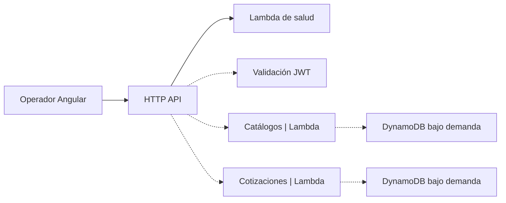

# Arquitectura de Cotizador de Catálogo

Un equipo comercial configura productos y cantidades, verifica opciones compatibles y obtiene una propuesta reproducible con el desglose de precios. El administrador del catálogo publica reglas versionadas. El comprador recibe una propuesta con la moneda, vigencia y condiciones que la generaron.

## Estado de la base

`infra/template.yaml` define una HTTP API con una Lambda Node.js 24 arm64 y un grupo de logs con retención marcada. Los servicios de dominio y sus recursos de datos corresponden al diseño del piloto. Las flechas punteadas del [diagrama](diagram.mmd) representan ese piloto.

## Responsabilidades y datos

| Dominio | Responsabilidad | Almacenamiento propuesto |
| --- | --- | --- |
| Catálogos | Productos, opciones, listas de precios y revisiones publicadas | DynamoDB. Clave de partición por organización y catálogo, revisión publicada inmutable. |
| Cotizaciones | Simulaciones, propuestas y vigencia comercial | DynamoDB. Clave por organización y cotización. Snapshot inmutable de importes, moneda y versión de catálogo al emitir. |

El servicio de Catálogos es dueño de publicación y revisiones. Cotizaciones lee una revisión publicada por un contrato de lectura. Puede iniciar con ambos Lambdas en un stack y tablas separadas. La cotización se calcula de forma síncrona en una Lambda con operaciones acotadas. El cálculo usa enteros en unidades monetarias menores y decisiones explícitas de redondeo. El piloto acepta cantidades enteras. Cada revisión se valida antes de publicar. Un fallo al emitir permite reintentar con la misma clave de idempotencia. Si la clave llega con otro contenido, el API devuelve conflicto.

Añadir una Lambda con SQS para exportación de documentos cuando se necesite entrega asíncrona y reintentos. Step Functions Standard queda reservado para importaciones largas con validación, publicación por etapas y seguimiento de ejecución. El cálculo interactivo permanece síncrono.

## Contratos previstos

| Operación | Alcance |
| --- | --- |
| GET /v1/catalogs/{catalogId}/versions/{version} | Consulta de una versión publicada con identidad de organización. |
| POST /v1/catalogs/{catalogId}/publications | Publicación condicional con número de versión y clave de idempotencia. |
| POST /v1/quotes/preview | Cálculo determinista a partir de versión, opciones y cantidades. Devuelve desglose y reglas aplicadas. |
| POST /v1/quotes | Emisión idempotente de una propuesta y su snapshot. |

Cada catálogo define moneda, exponente monetario, vigencia y política de redondeo. JavaScript usa bigint para aritmética interna y cadenas de enteros en JSON. Los porcentajes se expresan como fracciones enteras. Las reglas son tipos permitidos y parámetros validables. Toda edición incrementa versión. Publicar y emitir usan escrituras condicionales. Las cotizaciones guardan el snapshot comercial, de modo que volver a consultarlas produce el mismo desglose.

## Angular y operación

Angular standalone con rutas lazy por flujo. Estado de pantalla en Signals locales. Estado de cada flujo en NgRx SignalStore con proveedores por ruta. Las llamadas HTTP viven en el servicio de datos de cada función. El backend decide operaciones que afecten dinero. Los eventos conservan un id de correlación para seguimiento.

En el piloto, los bundles estáticos se pueden alojar en S3 privado con CloudFront y Origin Access Control. API Gateway valida tokens de Cognito o del proveedor OIDC. La Lambda verifica pertenencia y permisos sobre cada recurso. Separar lectores, vendedores y administradores. Validar la pertenencia a la organización antes de leer el catálogo o escribir la cotización. Evitar nombres de clientes, descuentos confidenciales y reglas completas en logs.

Los Lambdas escalan por invocación. El MVP usa DynamoDB bajo demanda y colas con límites explícitos. S3, logs y datos retenidos pueden generar cargos incluso cuando la aplicación no recibe solicitudes. Presupuestos, métricas de latencia y errores, retención y alarmas de cola se configuran por ambiente cuando se habiliten esos recursos.

## Casos de fallo a verificar

Cubrir importes extremos, opciones incompatibles, orden y prioridad de reglas, redondeo, caducidad, versión inexistente, edición concurrente y repetición de la misma solicitud de emisión.

## Referencias

- [Runtime Node.js en Lambda](https://docs.aws.amazon.com/lambda/latest/dg/lambda-nodejs.html)
- [DynamoDB bajo demanda](https://docs.aws.amazon.com/amazondynamodb/latest/developerguide/on-demand-capacity-mode.html)
- [Flujos de AWS Step Functions](https://docs.aws.amazon.com/step-functions/latest/dg/choosing-workflow-type.html)
