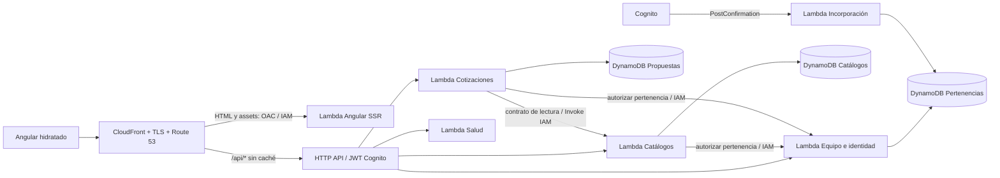

# Arquitectura de CotiTrama

Microservicios serverless en AWS, con Angular SSR alojado en Lambda. La base comercial, el registro con correo real y el núcleo de Equipo con su tabla propia de pertenencias están desplegados y verificados en development. La aceptación de Equipo incluye transacciones reales y navegador con JWT, con cambio y retirada de permisos efectivos sin esperar a renovar el token. Las revisiones de cada entrega y sus comprobaciones se registran en [Verificación](../verificacion.md). Testing y producción conservan sus puertas de promoción.

## Límites de servicio

| Servicio | Responsabilidad | Datos / permisos |
| --- | --- | --- |
| Web | SSR público, assets, configuración pública y navegación Angular | Sin acceso a tablas de negocio. Function URL IAM sólo invocable por CloudFront OAC. |
| Equipo e identidad | Pertenencias, contexto de organización, invitaciones y roles | `MembersTable` propia; consulta del pool Cognito propio para correo verificado y migración. Equipo y el trigger de incorporación son entradas del mismo dominio de identidad. |
| Catálogos | Publicación de revisiones, listado y lectura | Tabla propia e invocación IAM de Equipo para autorizar. Publicación condicional; una revisión publicada no se edita. |
| Cotizaciones | Motor determinista, simulación, emisión y consulta de snapshots | Tabla propia, autorización mediante Equipo e invocación de lectura de Catálogos. Sin acceso directo a sus tablas. |
| Salud | Respuesta técnica de disponibilidad de la función | Sin datos de negocio; no acredita salud de dependencias. |

Las funciones comparten utilidades de contrato, pero se ejecutan con roles separados. El monorepo no convierte los dominios en un único proceso. Catálogos y Cotizaciones no leen tablas de otros dominios: usan contratos de Lambda con permisos IAM. Equipo y el trigger de incorporación inicializan la tabla que pertenece a su propio dominio de identidad. En esta primera versión un stack SAM coordina los recursos; separar despliegues de dominio se puede realizar conservando los contratos.

## Frontend y dominios

Angular 22 standalone, rutas lazy por flujo, SignalStore por ruta y HttpClient tipado. El navegador inicia sesión mediante Authorization Code con PKCE. SSR no carga datos comerciales ni serializa tokens en HTML. El backend calcula todos los importes.

Se reutiliza el patrón del portafolio: Express + AngularNodeAppEngine + serverless-http dentro de Lambda Node.js 24 arm64. CloudFront usa un origen OAC para la Function URL IAM de Web y otro origen HTTP API para `/api/*`; los POST de negocio no atraviesan la Function URL del frontend. HTML, configuración y respuestas comerciales no se cachean; los assets con hash permiten caché inmutable en el navegador.

Route 53 publica únicamente los aliases del producto: `cotitrama-dev.lynxpardelle.com`, `cotitrama-test.lynxpardelle.com` y `cotitrama.lynxpardelle.com`. El certificado ACM de CloudFront debe existir en us-east-1 y cubrir el nombre del ambiente. No se reemplazan aliases del portafolio ni se cambian nameservers.

## Identidad y aislamiento

Cada ambiente crea su Cognito UserPool, cliente público sin secreto y dominio de autenticación. El registro público usa la pantalla gestionada de Cognito y exige verificar el correo; la recepción y confirmación con correo real se comprobaron en development. PostConfirmation deriva una organización del pool y del `sub` confirmado, mantiene el grupo histórico `org:<organizationId>:admin` e inicializa su perfil y pertenencia en `MembersTable` de manera idempotente. El cliente no puede elegir la organización ni el rol de alta. La recuperación de contraseña no crea otra organización.

API Gateway valida firma, issuer, audience, vencimiento y scope; los servicios exigen token de acceso y extraen su `sub`. **La autoridad del rol y la pertenencia es DynamoDB, no los grupos presentes en un token antiguo.** Catálogos y Cotizaciones invocan Equipo por IAM para resolver esa identidad en cada solicitud. Un fallo del servicio de pertenencias cierra el acceso con error 503; no degrada a confiar en claims históricos.

La cabecera `X-Organization-Id` expresa qué espacio desea usar el cliente. Equipo valida su formato y comprueba la pertenencia actual en la base antes de devolver organización y rol. Omitirla usa la organización predeterminada disponible; `GET /team/context` permite recuperar una selección que dejó de estar disponible. Elegir un espacio ajeno en una operación protegida se rechaza, y consultar un recurso ajeno dentro del contexto autorizado devuelve 404. Un campo del body no concede pertenencia. Todas las claves comerciales se construyen con la organización validada en servidor. Publicar requiere admin; simular/emitir admin o seller; consultar admite reader.

Una cuenta puede conservar su espacio propio y pertenecer a otros por invitación. Angular carga el contexto, permite seleccionar espacio y limpia el estado de catálogo/cotización al cambiarlo. La gestión visual de miembros permite invitar, cambiar roles y retirar accesos; las mutaciones de administración se vuelven a autorizar en la transacción. Un contador `adminCount` condicional impide retirar o degradar al último administrador, incluso con cambios concurrentes. Los tokens se conservan durante la sesión del navegador, con vencimiento y limpieza al salir; no se incluyen en logs ni en SSR.

### Migración e invitaciones

Las cuentas anteriores se inicializan una sola vez: si falta `USER#/PROFILE`, Equipo consulta usuario y grupos actuales directamente al pool Cognito configurado mediante IAM y crea perfil, índices de pertenencia y contador de administradores en transacción. No usa grupos aportados por el JWT. Una vez creado `PROFILE`, retirar una pertenencia no elimina ese marcador; los grupos heredados no pueden resucitar el acceso en la siguiente solicitud. La inicialización admite hasta 32 organizaciones heredadas; un caso superior requiere revisión operativa.

El administrador genera un enlace manual dirigido a un correo y rol. El token aleatorio tiene 256 bits, se devuelve al crear la invitación y sólo su hash SHA-256 se persiste. Caduca a los siete días; no se envía correo de invitación automáticamente. Para consultar o aceptar se exige una cuenta del pool con el mismo correo normalizado y verificado. La aceptación transaccional es idempotente y no sustituye un rol existente. Reabrir un enlace ya aceptado no restaura una pertenencia que después se retiró. El enlace es sensible: compartirlo únicamente con la persona destinataria.

## Contratos HTTP

| Operación | Resultado |
| --- | --- |
| GET /api/health | Salud técnica pública de la función. |
| GET /api/v1/catalogs | Catálogos publicados de la organización, revisión más reciente. |
| GET /api/v1/catalogs/{catalogId}/versions/{version} | Revisión exacta e inmutable. |
| POST /api/v1/catalogs/{catalogId}/publications | Publicación condicional de una revisión validada. |
| POST /api/v1/quotes/preview | Desglose determinista y reglas aplicadas. |
| POST /api/v1/quotes | Emisión con cabecera Idempotency-Key y snapshot inmutable. |
| GET /api/v1/quotes/{quoteId} | Consulta de la propuesta conservada. |
| GET /api/v1/team/context | Pertenencias actuales y organización seleccionada disponible. |
| GET /api/v1/team/members | Miembros del espacio; requiere admin. |
| POST /api/v1/team/invitations | Invitación por correo/rol y token para compartir manualmente; requiere admin. |
| GET /api/v1/team/invitations/{token} | Detalle dirigido al correo verificado de la cuenta autenticada. |
| POST /api/v1/team/invitations/{token}/accept | Aceptación idempotente sin datos adicionales en el body. |
| PATCH /api/v1/team/members/{subject} | Cambio de rol autorizado y protegido contra pérdida del último admin. |
| DELETE /api/v1/team/members/{subject} | Retirada de pertenencia con la misma protección. |

El catálogo declara moneda, exponente, vigencia y redondeo. El motor usa BigInt; JSON transporta cadenas de enteros en unidades menores. Los porcentajes son razones enteras y las reglas se ordenan de manera estable por prioridad. Se validan cantidades, opciones incompatibles, revisión exacta, caducidad y límites monetarios antes de emitir. El fixture en `services/fixtures/catalog.mjs` documenta el contrato ejecutable.

La tabla de propuestas conserva el snapshot y la clave de idempotencia en una transacción condicional. Repetir el mismo contenido devuelve el resultado original; reutilizar la clave con otro contenido produce 409. La emisión no altera su resultado cuando se publica otra revisión.

## Operación y límites

DynamoDB bajo demanda, cifrado, recuperación a un punto en el tiempo y retención de tablas al eliminar el stack. Logs con 14 días de retención; nunca registrar payloads comerciales ni tokens. HTTP API limita el caudal. Los recursos se aíslan por stack y ambiente; la elevación sigue development → testing → main.

La demo en loopback usa datos sintéticos y repositorios en memoria, separados de los adaptadores AWS. Las pruebas locales no sustituyen la comprobación de IAM, JWT, condiciones/transacciones DynamoDB y DNS/TLS en development. Los tiempos de usuarios, correcciones y reutilización de reglas requieren un piloto autorizado. Exportación asíncrona/SQS e importaciones largas/Step Functions quedan fuera del primer flujo.

## Referencias

- [Angular SSR](https://angular.dev/guide/ssr)
- [CloudFront OAC para Lambda](https://docs.aws.amazon.com/AmazonCloudFront/latest/DeveloperGuide/private-content-restricting-access-to-lambda.html)
- [Autorizadores JWT en HTTP API](https://docs.aws.amazon.com/apigateway/latest/developerguide/http-api-jwt-authorizer.html)
- [Transacciones DynamoDB](https://docs.aws.amazon.com/amazondynamodb/latest/developerguide/transaction-apis.html)

## Sitio comercial y planes

La raíz pública sirve una landing SSR con propuesta de valor, muestra de propuesta, flujo de trabajo, preguntas frecuentes y registro. La fuente compartida `services/shared/plans.json` declara Esencial **$399 MXN/mes** (2 miembros, 2 catálogos y 100 propuestas), Equipo **$1,199** (8/10/1,000) y Empresa **$3,499** (25/50/5,000). Los precios siguen propuestos antes de impuestos; las capacidades se comprueban en backend sin contratación ni cobros. Cada dominio actualiza su contador en la misma transacción que consume capacidad. `/consumo` muestra los tres dominios y avisos desde el 80%. El piloto continúa sin cargos y Stripe sigue pendiente. [Diseño de suscripciones](../planes-suscripcion.md) y [límites, migración y consumo](003-limites-y-consumo.md). Las rutas de trabajo permanecen separadas del sitio público. Desarrollo envía X-Robots-Tag noindex,nofollow.

El trigger de confirmación sólo recibe invocaciones de Cognito del pool propio. Su rol puede crear grupos y asignar miembros únicamente en ese pool e inicializar la tabla propia de pertenencias; la política del pool se adjunta como recurso separado para evitar un ciclo entre UserPool y función. Equipo sólo consulta datos de usuario/grupos en ese pool y opera su tabla; los servicios comerciales únicamente lo invocan. Hay alarmas de errores de incorporación, Equipo y API5xx, además de las funciones de negocio. El despliegue de Equipo y sus transacciones en development ya se comprobaron; cada actualización debe conservar esa aceptación y su evidencia.
